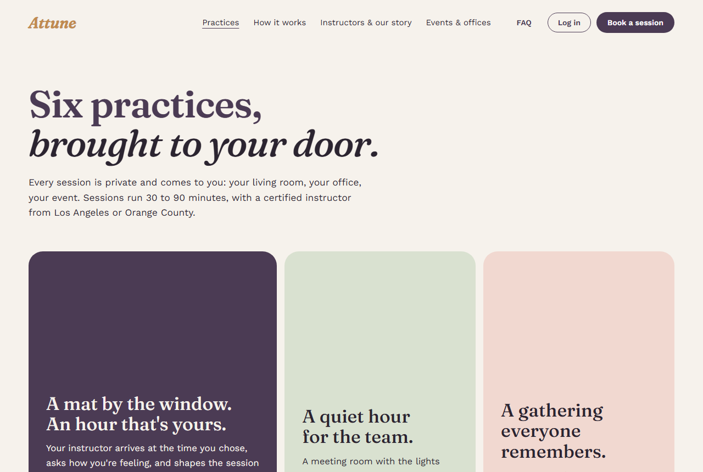
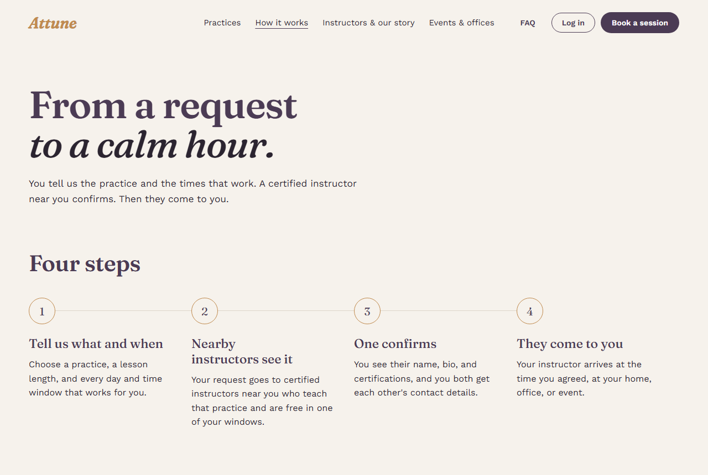
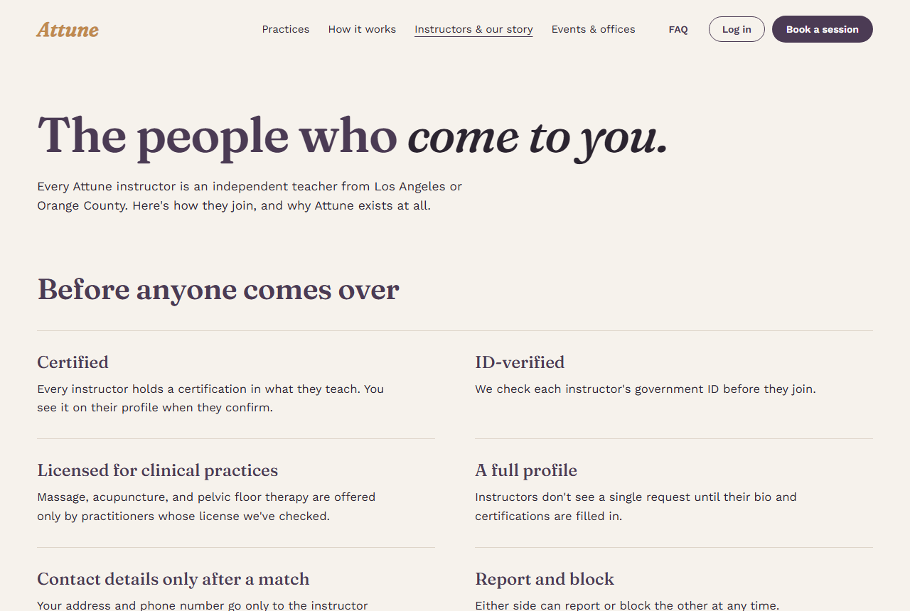
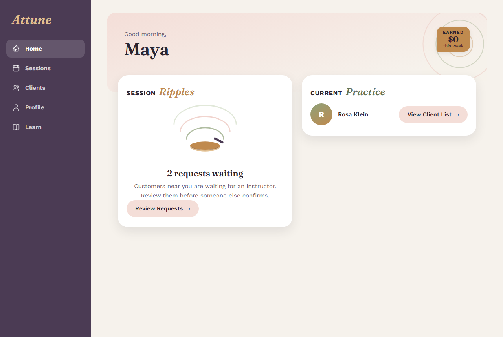
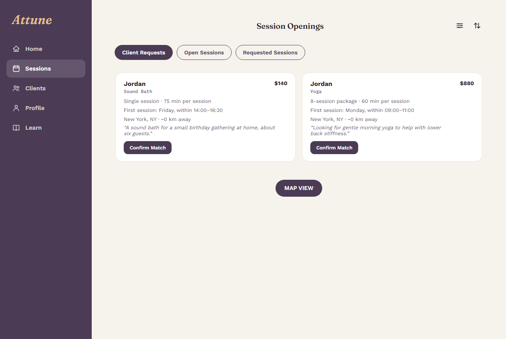
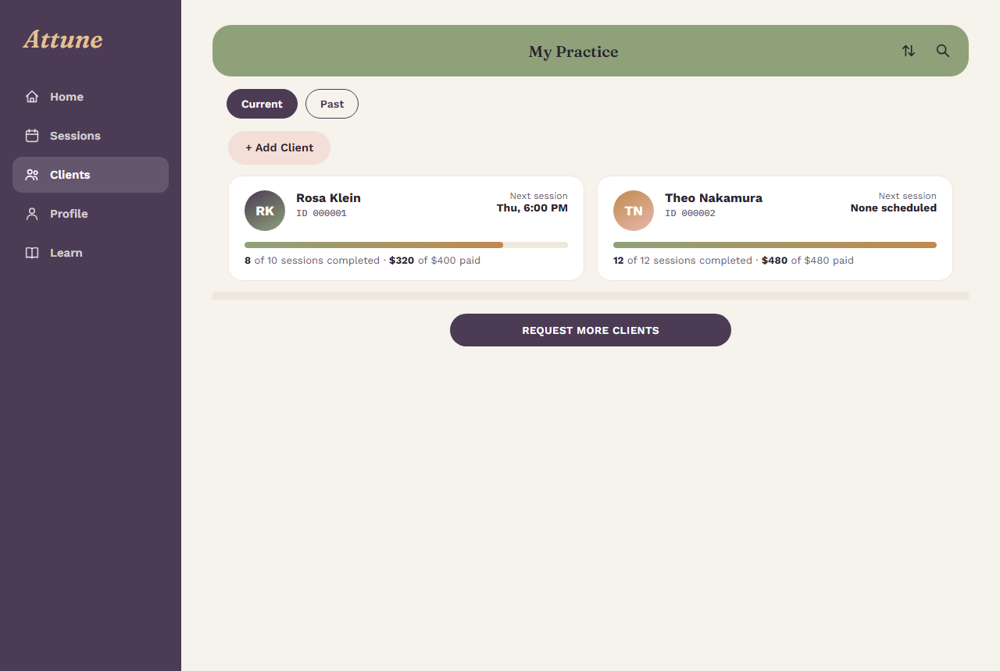
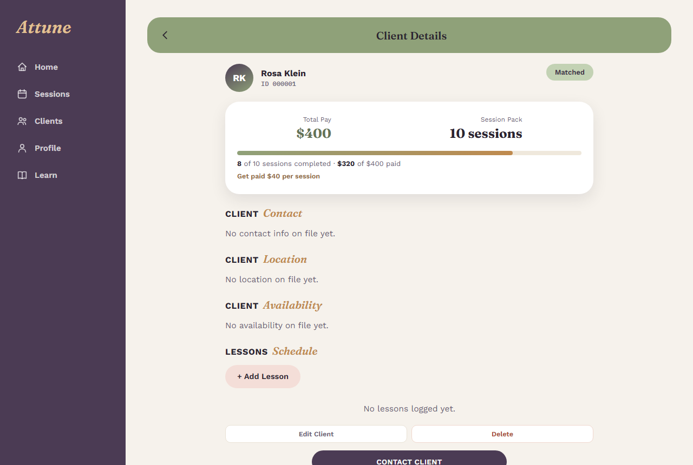
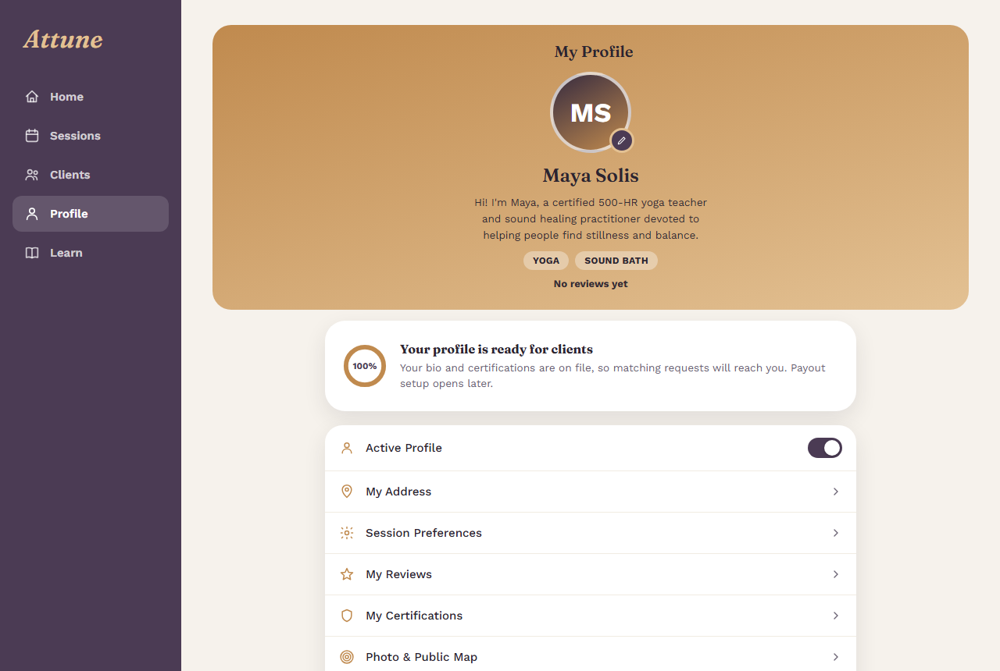
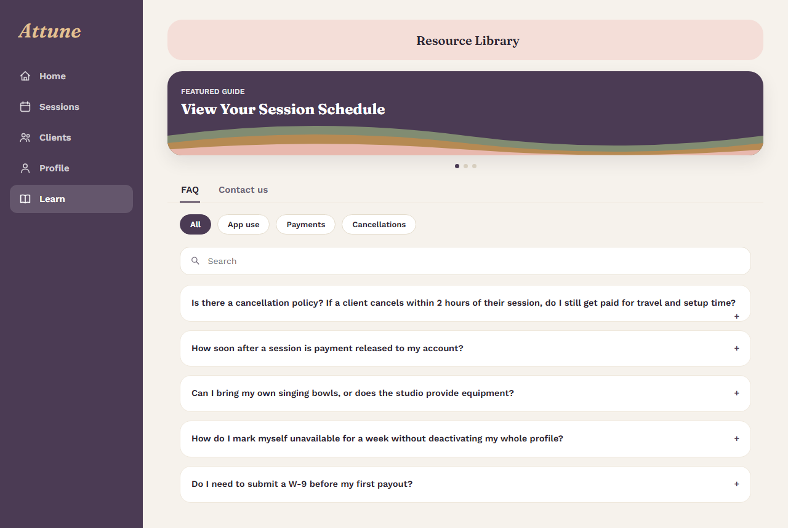

# Attune (Showcase)

A marketplace for private yoga, sound baths, meditation, massage, acupuncture, and pelvic floor therapy in Los Angeles and Orange County. Attune matches customers with qualified practitioners for sessions at home, at the office, or at an event.

> This is a showcase repo. The source code is private. Code walkthroughs are available on request.

**Live site:** [Explore Attune](https://attune-lusx.onrender.com/customer)  
**Contact:** jahan.atkins815@gmail.com | [linkedin.com/in/jahan-atkins-39002b419](https://linkedin.com/in/jahan-atkins-39002b419)

## Why I built it

My mom is a yoga teacher, and as a small independent instructor she struggled to find steady work. Studios pay teachers a flat class rate, and general gig sites charge instructors for leads whether or not they ever get paid. With Attune, customers say what they want and nearby qualified instructors can accept the request.

I started Attune in August 2026 as a solo founder.

## How it works

1. **The customer describes what they want.** They choose a practice, a package or a scheduled session, and the times that work for them.
2. **The request is broadcast, not assigned.** It goes into the queue of every instructor who matches on specialty, is within their own travel-distance preference, and (for scheduled lessons) has a real opening that fits the full lesson length.
3. **An instructor confirms.** Only at that moment is the booking finalized, and the customer becomes a client in that instructor's dashboard. Until then, instructors see only the customer's first name. Attune shares full contact details only with the confirming instructor.
4. **After the session**, the customer can leave a review, rebook the same instructor, or set up a standing weekly booking.

## Screenshots

### Customer website

| Home | Practices |
|---|---|
|  |  |

| How it works | Instructors and our story |
|---|---|
|  |  |

### Instructor app

| Home | Client requests | Clients |
|---|---|---|
|  |  |  |

| Client details | Profile | Learn |
|---|---|---|
|  |  |  |

The client requests queue shows pending customer requests with the package, distance, price, and the customer's notes. Instructors see only the customer's first name until they confirm.

### Log in screens

| Instructor | Admin |
|---|---|
|  |  |

The customer website and sign-in screenshots are from the current live site. The logged-in screens use fictional demo data.

## What's built

**Three web apps, one backend**
- **Customer website and app:** a public site with a map home page, practices, how it works, events, and instructor pages; sign up, request a package or scheduled lesson, view booking history, review and rebook instructors, manage recurring bookings.
- **Instructor app:** clients, session listings, weekly availability, a map of incoming client requests, profile, photo and specialties, an opt-in spot on the public map, reviews, recurring series, and Stripe Connect payout onboarding. It works as a phone app and has a full website layout on computers.
- **Admin app:** platform metrics, account suspension, force-cancelling requests, approving client deletions, verifying licenses for clinical practices, FAQ management, and an activity log of every admin action.

**Native iOS app** built in SwiftUI with customer and instructor roles and XCUITest coverage. App Store release is on the roadmap.

**Payment status.** Instructors can start Stripe Connect onboarding. Confirmed requests are marked payment pending. Live customer charges and instructor payouts are still ahead.

## Social media automation

I built Creative Studio into the Attune admin to manage short-form content for Instagram and TikTok. It brings together content briefs, video rendering, caption review, and scheduling. A person reviews and approves the exact video and caption before it can be sent for publishing.

The deployed workflow can export finished videos and their breakdowns to Obsidian. The analytics integration is designed to record each post's performance after 24 hours, 72 hours, and one week. Live publishing and analytics still need the social accounts connected and the publishing integration enabled.

## Tech stack

| Layer | Tools |
|---|---|
| Backend | Python, FastAPI, Pydantic |
| Database | SQLAlchemy, Alembic, SQLite locally, Supabase Postgres in production |
| Auth | JWT with typed tokens, bcrypt, Google sign-in, password reset by email, two-factor login for admins |
| Payments | Stripe Connect Express onboarding |
| Web frontends | Vanilla HTML, CSS, and JavaScript (no build step), Leaflet maps, installable PWA |
| iOS | SwiftUI, XCUITest |
| Testing | pytest, GitHub Actions |
| Hosting | Render, deployed from a Render Blueprint |

## Architecture

```
Customer web app  --\
Instructor web app ---> FastAPI (one process) --> SQLAlchemy --> Supabase Postgres
Admin web app     --/          |                                   (RLS on every table)
iOS app (SwiftUI) -/           +-- JWT auth (instructor / customer / admin + 2FA)
                               +-- Matching engine (specialty, distance, time overlap)
                               +-- Stripe Connect, email, geocoding
                               +-- Admin audit log
```

## Engineering highlights

**Matching engine.** A scheduled lesson only matches when a full-length slot fits inside the overlap of the customer's window and the instructor's availability, not just when the two windows touch. Slots already given to another customer are excluded, so the same hour can never be sold twice. Distance uses the haversine formula against each instructor's own travel limit. The matching logic is pure Python with no database or web framework, so it is unit tested directly.

**Request, then confirm.** Bookings start as pending with no instructor and nothing charged. Only the confirm route can assign an instructor, and it re-checks eligibility on the server at that moment instead of trusting what the instructor's screen showed. Tests cover race conditions such as two instructors confirming the same request.

**Access control.** Every client and session query is scoped to the logged-in instructor, and tests prove one instructor cannot read another's data. Tokens carry a type, so a customer token is rejected on instructor routes and vice versa. There is deliberately no admin signup endpoint anywhere; admin accounts can only be created from a local script. Suspension (admin-controlled) and availability (instructor-controlled) are separate flags, and both are checked in every matching query.

**Hardened admin access.** Admin login takes a password and a one-time code from an authenticator app. Two-factor setup can only happen from a local script, each code works once, and a wrong password and a wrong code get the same answer. Every admin change is written to an append-only activity log in the same database transaction, and a test fails if a new admin route skips the log.

**Privacy by default.** Instructors who see a pending request get only the customer's first name, enforced by the API, not just hidden in the app. Clinical practices (massage, acupuncture, pelvic floor therapy) stay locked until an admin verifies the practitioner's license. Uploaded photos are checked by their actual contents and size-capped, and the public map never shows an address, email, or phone number.

**Security work.** A security audit fixed a reflected XSS in password reset, email-enumeration timing differences, a JWT crash, Stripe return-URL host injection, and SQL LIKE wildcard injection in admin search, and added security headers (HSTS, frame and object restrictions). Login and signup are rate limited, interactive API docs are disabled in production, and every production table has Postgres row-level security enabled.

**Simulation testing.** I ran a 14-persona simulated customer test against the app. It found double booking, crashes on malformed times, recurring-series cancellation bugs, duplicate-signup races, and missing input-length limits, all of which were fixed and locked in with regression tests.

**Accessibility pass.** A UI audit led to accessible text contrast, real buttons and switches, labeled form fields, screen-reader error messages, and keyboard focus handling across all three web apps, without changing the brand.

**Deploy pipeline.** Every push runs the full pytest suite plus a job that applies all migrations to a real Postgres 17 database, since some migrations behave differently on Postgres than on SQLite. Render migrates the schema before new code goes live.

## Business model

Attune plans to earn revenue on completed bookings.

## What I learned

- Designing a two-sided marketplace where trust and timing matter more than browsing
- Writing access-control rules once and proving them with tests instead of hoping
- Thinking like an attacker: auditing my own app and fixing what I found
- Running schema migrations safely against a live production database
- Shipping the same product on web and native iOS from one backend

## Roadmap

- Enable live customer payments and instructor payouts through Stripe
- Release the iOS app on the App Store
