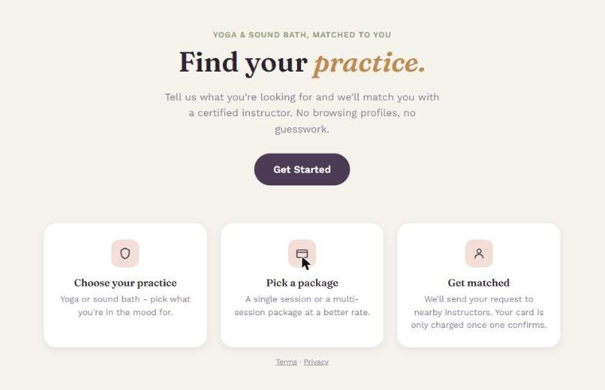
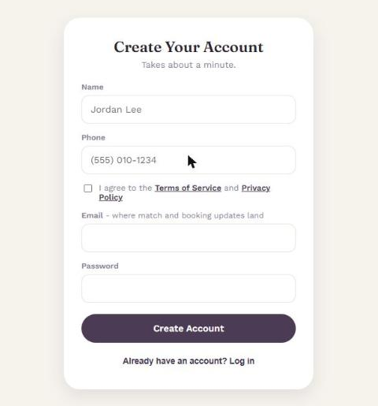
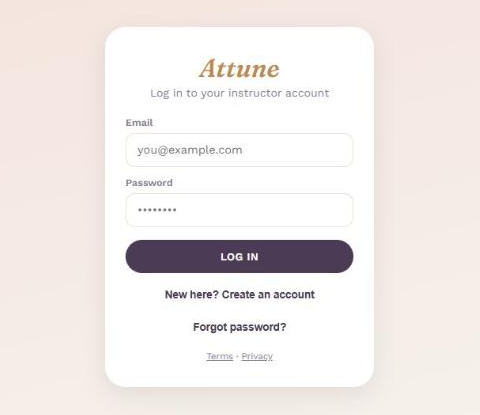
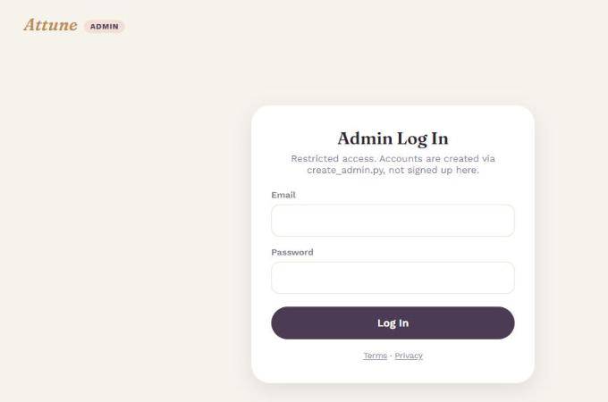

# Attune (Showcase)

A two-sided marketplace that matches customers with private yoga and sound bath instructors for in-home, office, and event sessions in Los Angeles and Orange County.

> This is a showcase repo. The source code is private. Code walkthroughs are available on request.

**Live site:** [attune-lusx.onrender.com/customer](https://attune-lusx.onrender.com/customer) (free hosting tier, so the first load can take up to a minute)
**Contact:** jahan.atkins815@gmail.com | [linkedin.com/in/jahan-atkins-39002b419](https://linkedin.com/in/jahan-atkins-39002b419)



## Why I built it

My mom is a yoga teacher, and as a small independent instructor she struggled to find steady work. Studios pay teachers a flat class rate, and general gig sites charge instructors for leads whether or not they ever get paid. Attune flips that: customers say what they want, nearby qualified instructors see the request, and the platform only earns money when a session is actually booked.

I started Attune in August 2026 as a solo founder. 15 instructors have committed to the platform ahead of launch.

## How it works

1. **The customer describes what they want.** Yoga or sound bath, a package or a specific scheduled lesson, the days and times that work, and how long the lesson should be. There are no profiles to scroll through.
2. **The request is broadcast, not assigned.** It goes into the queue of every instructor who matches on specialty, is within their own travel-distance preference, and (for scheduled lessons) has a real opening that fits the full lesson length.
3. **An instructor confirms.** Only at that moment is the booking finalized, and the customer automatically becomes a client in that instructor's dashboard. Contact info is exchanged only with the instructor who confirmed, never with everyone who saw the request.
4. **After the session**, the customer can leave a review, rebook the same instructor, or set up a standing weekly booking.

## Screenshots

| Customer sign up | Instructor log in | Admin log in |
|---|---|---|
|  |  |  |

Captured from the live deployment. Logged-in dashboards hold real account data, so they are shown in walkthroughs rather than here.

## What's built

**Three web apps, one backend**
- **Customer app:** sign up, request a package or scheduled lesson, view booking history, review and rebook instructors, manage recurring bookings.
- **Instructor app:** clients, session listings, weekly availability, a map of incoming client requests, profile and specialties, reviews, recurring series, and Stripe Connect payout onboarding.
- **Admin app:** platform metrics, account suspension, force-cancelling requests, approving client deletions, verifying clinical specialties, and FAQ management.

**Native iOS app** in SwiftUI (separate repo) with customer and instructor roles, tested with XCUITest in Xcode.

## Tech stack

| Layer | Tools |
|---|---|
| Backend | Python, FastAPI, Pydantic |
| Database | SQLAlchemy, Alembic (23 migrations), SQLite locally, Supabase Postgres in production |
| Auth | JWT with typed tokens, bcrypt, Google sign-in, password reset by email |
| Payments | Stripe Connect Express onboarding |
| Web frontends | Vanilla HTML, CSS, and JavaScript (no build step), Leaflet maps, installable PWA |
| iOS | SwiftUI, XCUITest |
| Testing | pytest (431 passing tests), GitHub Actions |
| Hosting | Render, deployed from a Render Blueprint |

## Architecture

```
Customer web app  --\
Instructor web app ---> FastAPI (one process) --> SQLAlchemy --> Supabase Postgres
Admin web app     --/          |                                   (RLS on every table)
iOS app (SwiftUI) -/           +-- JWT auth (instructor / customer / admin)
                               +-- Matching engine (specialty, distance, time overlap)
                               +-- Stripe Connect, email, geocoding
```

## Engineering highlights

**Matching engine.** A scheduled lesson only matches when a full-length slot fits inside the overlap of the customer's window and the instructor's availability, not just when the two windows touch. Slots already given to another customer are excluded, so the same hour can never be sold twice. Distance uses the haversine formula against each instructor's own travel limit. The matching logic is pure Python with no database or web framework, so it is unit tested directly.

**Request, then confirm.** Bookings start as pending with no instructor and nothing charged. Only the confirm route can assign an instructor, and it re-checks eligibility on the server at that moment instead of trusting what the instructor's screen showed. Tests cover race conditions such as two instructors confirming the same request.

**Access control.** Every client and session query is scoped to the logged-in instructor, and tests prove one instructor cannot read another's data. Tokens carry a type, so a customer token is rejected on instructor routes and vice versa. There is deliberately no admin signup endpoint anywhere; admin accounts can only be created from a local script. Suspension (admin-controlled) and availability (instructor-controlled) are separate flags, and both are checked in every matching query.

**Security work.** A security audit fixed a reflected XSS in password reset, email-enumeration timing differences, a JWT crash, Stripe return-URL host injection, and SQL LIKE wildcard injection in admin search, and added security headers (HSTS, frame and object restrictions). Login and signup are rate limited, interactive API docs are disabled in production, and every production table has Postgres row-level security enabled.

**Payments done safely.** The API never receives card numbers, which keeps it out of the heaviest PCI scope. Card entry will be handled by Stripe's own UI, and the server only ever sees Stripe IDs. Instructors already onboard to Stripe Connect so they are payout-ready.

**Simulation testing.** I ran a 14-persona simulated customer test against the app. It found double booking, crashes on malformed times, recurring-series cancellation bugs, duplicate-signup races, and missing input-length limits, all of which were fixed and locked in with regression tests.

**Deploy pipeline.** Every push runs the full pytest suite plus a job that applies all migrations to a real Postgres 17 database, since some migrations behave differently on Postgres than on SQLite. Render migrates the schema before new code goes live.

## Business model

A split fee on each booking: a small service fee on the customer side and a commission on the instructor side, so Attune earns only when an instructor gets paid.

## What I learned

- Designing a two-sided marketplace where trust and timing matter more than browsing
- Writing access-control rules once and proving them with tests instead of hoping
- Thinking like an attacker: auditing my own app and fixing what I found
- Running schema migrations safely against a live production database
- Shipping the same product on web and native iOS from one backend

## Roadmap

- Real customer payments through Stripe, holding funds until a session is completed
- App Store launch for the iOS app
- Mat Pilates as a new category after launch
